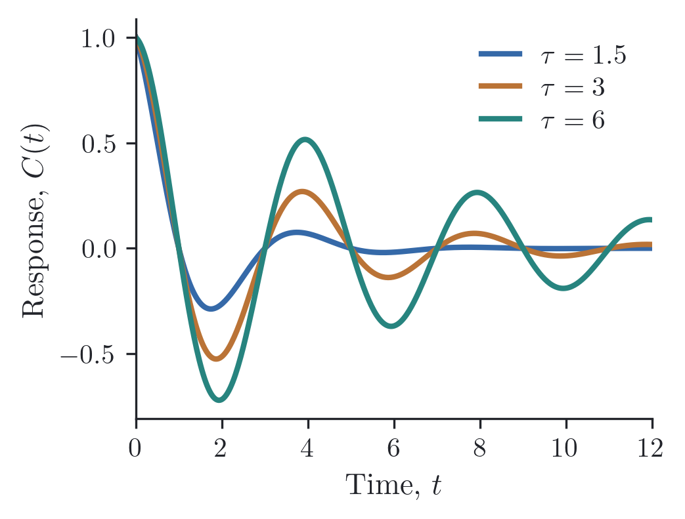
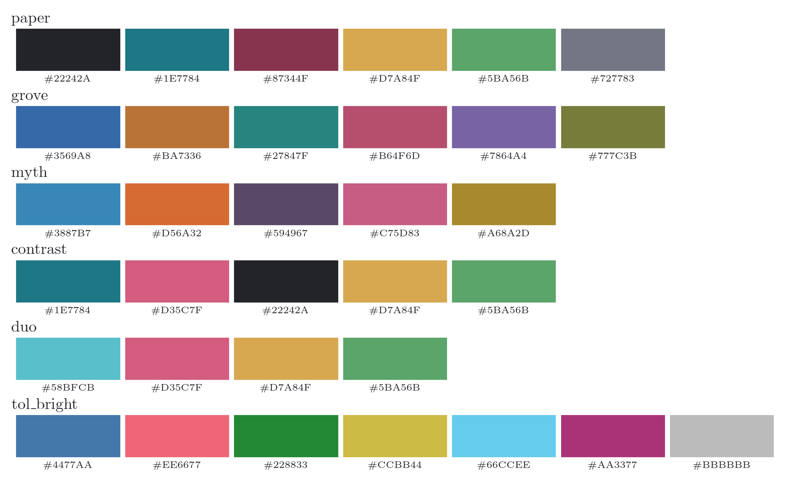
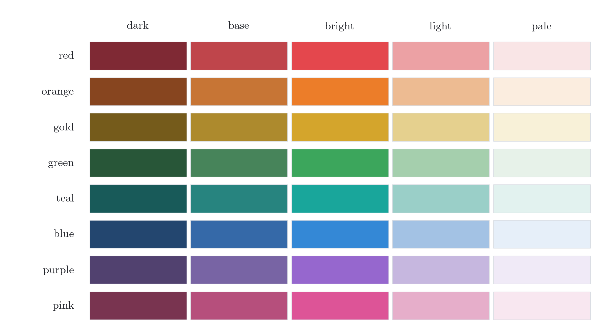
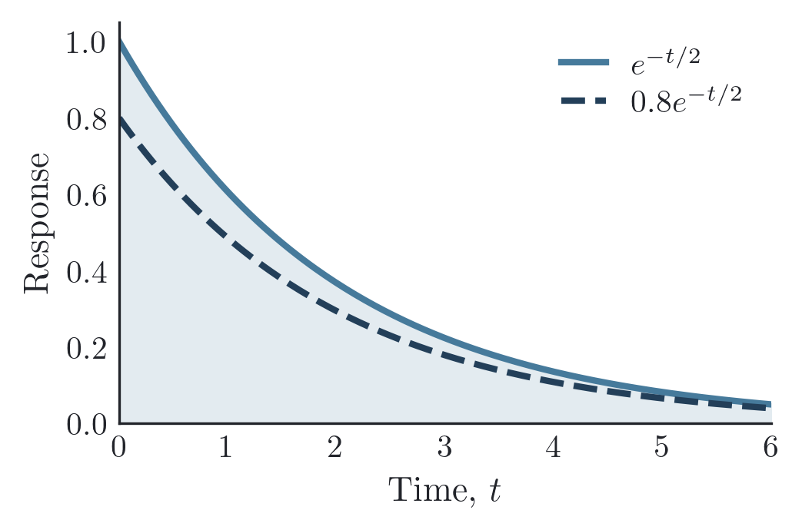
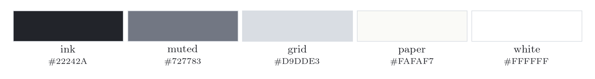
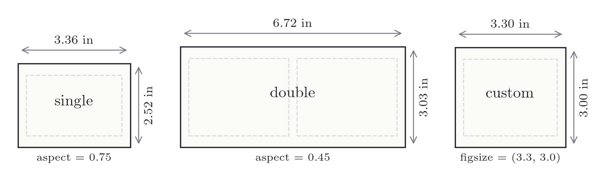
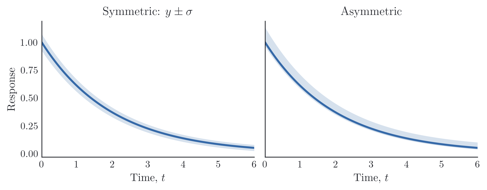
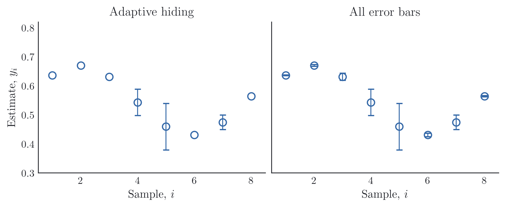

# reiplotlib

Small Matplotlib helpers for scientific figures: color palettes, LaTeX styling,
publication sizes, adaptive error bars, and PNG/PDF export. Use regular Matplotlib
axes and add the pieces you need.

Part of **Reiko Studio**.

## Installation

```bash
pip install git+https://github.com/reiko-studio/reiplotlib.git
```

Requires Python ≥3.10 and Matplotlib ≥3.7. LaTeX rendering is enabled by default;
set `text.usetex` to `False` to use Matplotlib's built-in text rendering.

## A first figure

Plot three damped oscillations with matching shaded bands. Grove supplies the
line colors automatically; `line.get_color()` gives each band the same color.
The bands here are illustrative, not estimated uncertainties.

```python
import numpy as np
import reiplotlib as rpl
from reiplotlib import layouts as layout, options as o

x = np.linspace(0, 12, 400)

with rpl.rc_context({"text.usetex": True}):
    fig, ax = layout.subplots(width="double", aspect=0.46, layout="constrained")
    for tau in (1.5, 3.0, 6.0):
        envelope = np.exp(-x / tau)
        y = envelope * np.cos(2 * np.pi * x / 4)
        band = 0.06 * envelope
        line, = ax.plot(x, y, label=rf"$\tau={tau:g}$",
                        marker="o", markersize=3, markevery=32, linewidth=1.5)
        ax.fill_between(x, y - band, y + band,
                        **o.fill(line.get_color(), alpha=0.16))
    ax.axhline(0, color=rpl.colors.neutral.muted, lw=0.7, ls=":")
    ax.set(xlim=(0, 12), xlabel=r"Time, $t$",
           ylabel=r"Response, $C(t)$",
           title=r"$C(t)=e^{-t/\tau}\cos(\pi t/2)$")
    rpl.clean_axes(ax, grid=False)
    rpl.clean_legend(ax, ncols=3, loc="upper right")
    rpl.export.savefig(fig, "figures/response")
```



Run this with a working LaTeX installation to save `figures/response.png` and
`figures/response.pdf`. `rc_context()` restores your Matplotlib settings when the
block ends. To style an entire script instead, call `rpl.apply_style()` once.

## Palettes



Grove is the default series cycle. Text and axes use neutral ink, with white
backgrounds and gray gridlines. Choose another palette before plotting:

```python
from reiplotlib import palettes as p

rpl.use_palette(ax, p.myth)
ax.plot(x, y)
```

Use `p.grove[0]` for an explicit color or `p.get("grove")` to look up a palette
by name. Each entry is a string accepted by Matplotlib. Cycles repeat after the
last color; markers and line styles help distinguish larger sets of curves.

Paper combines ink and gray with teal, burgundy, gold, and green. Myth draws on
Hololive Myth's member colors, adapted for plotting on white rather than using
official color specifications. Contrast and Duo offer smaller sets.
[Tol Bright](https://sronpersonalpages.nl/~pault/#sec:qualitative) uses Paul Tol's
seven published colors and recommended order. Tol documents its color-vision
accessibility; the custom palettes have not been independently validated.

## Named colors

Pick a color family directly, or choose a shade:

```python
from reiplotlib import colors as c

ax.plot(x, y, color=c.red)
ax.plot(x, y_reference, color=c.blue.dark)
ax.fill_between(x, lo, hi, color=c.red.pale)
```



Each family is a color string: `c.red` and `c.red.base` have the same value.
Shades are attributes: `.dark`, `.base`, `.bright`, `.light`, and `.pale`.
Use base and dark shades for lines, bright shades for accents, and light or pale
shades for fills. These are curated choices, not uniform numerical color scales.
`c.named["red.dark"]` looks up a shade; `c.families` lists the eight families.

### Your own color

`NamedColor` builds a shade family from any opaque hex color:

```python
custom = rpl.NamedColor("#467A9B")
custom.dark = "#233F59"  # Override one generated shade.

with rpl.rc_context({"text.usetex": True}):
    fig, ax = layout.subplots(width="single", aspect=0.65, layout="constrained")
    x = np.linspace(0, 6, 200)
    y = np.exp(-x / 2)
    ax.fill_between(x, 0, y, color=custom.pale)
    ax.plot(x, y, color=custom, label=r"$e^{-t/2}$")
    ax.plot(x, 0.8 * y, color=custom.dark, ls="--", label=r"$0.8e^{-t/2}$")
    ax.set(xlabel=r"Time, $t$", ylabel="Response", xlim=(0, 6), ylim=(0, 1.05))
    rpl.clean_axes(ax, grid=False)
    rpl.clean_legend(ax)
    rpl.export.savefig(fig, "figures/custom-color")
```



The constructor accepts `#RGB` or `#RRGGBB`. `.dark` mixes 35% black into the
base; `.light` and `.pale` mix in 55% and 85% white in sRGB. `.bright` moves HLS
saturation 25% toward full saturation and lightness 10% toward white. These are
best-effort shades, not a perceptually uniform scale.

All five attributes are editable. Setting `custom.base = "#B64F7C"` regenerates
the whole family, replacing previous overrides. Set individual shades afterward.
Use `custom` directly with Matplotlib, or `custom.base` for a hex string. Changes
apply to subsequent plotting calls; update existing artists explicitly with
`line.set_color(custom.base)`.

### Neutrals

The neutral family covers text, reference lines, backgrounds, and grids.



```python
from reiplotlib import colors as c

ax.axhline(0, color=c.neutral.muted, linestyle=":")
ax.set_facecolor(c.neutral.paper)
ax.set_title("Response", color=c.neutral.ink)
```

Use `ink` for text and outlines, `muted` for secondary annotations, and `grid`
for light guides. `paper` is a warm off-white; `white` is pure white. All are
ordinary color strings and work directly with Matplotlib.

## Size and style

`layouts.subplots()` uses PRL single- and double-column widths. `aspect` is height
divided by width; other arguments pass through to Matplotlib.



```python
from reiplotlib import layouts as layout

fig, ax = layout.subplots(width="single", aspect=0.75)
fig, axs = layout.subplots(1, 2, width="double", aspect=0.45)
fig, ax = layout.subplots(figsize=(3.3, 3.0))
```

Single-column width is 243 TeX points (3.36 inches); double-column width is
486 points (6.72 inches). Width and aspect describe the whole figure, including
all panels. The sketches use a common scale; dashed boxes indicate plot areas.

An explicit `figsize` takes precedence. `layout.size("single", aspect=0.75)`
returns dimensions in inches for use with `plt.subplots()`.
These are figure canvas dimensions; tight cropping during export can change
the saved bounds. Use `bbox_inches=None` when the exported size must be exact.

Option presets return keyword dictionaries for ordinary plotting calls:

```python
ax.plot(x, y, **o.line(p.grove[0], linewidth=1.2, linestyle="--"))
ax.scatter(x, y, **o.scatter(p.grove[1], s=12))
ax.fill_between(x, lo, hi, **o.fill(p.grove[0], alpha=0.2))
```

Pass a color explicitly when using these presets; they carry their own color
rather than advancing the axes cycle. Use `ax.plot(x, y)` for automatic colors.

`rpl.clean_axes(ax, grid=False)` removes the top and right spines and tick marks.
`rpl.clean_legend(ax)` makes a compact legend from labeled artists. For panels,
use `rpl.label_panel(ax, "A")`; `rpl.percent_axis(ax, axis="y")` formats fractions
as percentages.

## Error bars and limits

### Shaded bands

Plot a line, then pass its uncertainties to `shade()`. The band takes the most
recent line's color unless you supply `color=`.

```python
with rpl.rc_context({"text.usetex": True}):
    fig, axes = layout.subplots(1, 2, width="double", aspect=0.38,
                               layout="constrained", sharey=True)
    x = np.linspace(0, 6, 200)
    y = np.exp(-x / 2)
    std = 0.025 + 0.05 * y

    axes[0].plot(x, y)
    rpl.shade(axes[0], x, y, std)
    axes[0].set_title(r"Symmetric: $y\pm\sigma$")

    axes[1].plot(x, y)
    rpl.shade(axes[1], x, y, (0.5 * std, 1.8 * std))
    axes[1].set_title("Asymmetric")

    for ax in axes:
        ax.set(xlabel=r"Time, $t$", xlim=(0, 6))
        rpl.clean_axes(ax, grid=False)
    axes[0].set_ylabel("Response")
    rpl.export.savefig(fig, "figures/shading")
```



`yerr` accepts a scalar, an array of symmetric widths, or a `(2, N)` array of
lower and upper widths. Widths are nonnegative distances from `y`, not absolute
bounds; pass whichever standard deviations or interval widths you computed.
`shade()` returns the filled artist and forwards options such as `alpha`,
`where`, `step`, and `label` to Matplotlib's `fill_between()`.

### Error bars

Draw uncertainties with `rpl.errorbar()`:

```python
with rpl.rc_context({"text.usetex": True}):
    fig, axes = layout.subplots(1, 2, width="double", aspect=0.40,
                               layout="constrained", sharex=True, sharey=True)
    x = np.arange(1, 9)
    y = 0.55 + 0.12 * np.sin(0.8 * x)
    se = np.array([0.001, 0.003, 0.012, 0.045, 0.080, 0.006, 0.025, 0.002])

    for ax, hide, title in zip(axes, (True, False),
                               ("Adaptive hiding", "All error bars")):
        rpl.errorbar(ax, x, y, yerr=se, hide_small_errors=hide,
                     **o.errorbar(rpl.colors.blue, markersize=7,
                                  markerfacecolor="none", markeredgewidth=1.2,
                                  capsize=3, elinewidth=0.9))
        ax.set(title=title, xlabel=r"Sample, $i$", xlim=(0.5, 8.5),
               ylim=(0.30, 0.82), xticks=[2, 4, 6, 8])
        rpl.clean_axes(ax, grid=False)
    axes[0].set_ylabel(r"Estimate, $y_i$")
    rpl.export.savefig(fig, "figures/errorbars")
```



Both panels use the same estimates and uncertainties. Hollow markers make small
bars visible in the right panel; adaptive hiding removes those shorter than the
marker diameter on the left.

Bars smaller than their markers are hidden individually and reappear when a zoom
or resize makes them visible. Caps follow their bars; the uncertainty values and
autoscaling bounds remain intact. Set `hide_small_errors=False` to show every
bar. Polar axes and one-sided limit arrows require this opt-out. Inputs are fixed
at creation; recreate the artist to change the data.

### Visible limits

To fit y limits to the visible x range:

```python
ax.set_xlim(2, 8)
rpl.autoscale_y(ax, margin=0.05)
```

Shared-y panels combine their visible ranges, including error bars and crossing
line segments. Manual y limits are preserved unless `override=True`. Lines,
scatter, and line collections are supported; images and filled bands are not.
Use `watch=True` to update on x-limit changes; the returned `(axes, callback_id)`
pairs can be disconnected with `axes.callbacks.disconnect(callback_id)`.

## Export

```python
rpl.export.savefig(fig, "figures/response")                 # PNG + PDF, 300 dpi
rpl.export.savefig(fig, "figures/draft", formats=("png",))  # PNG only
rpl.export.saveclose(fig, "figures/response")               # Save and close
```

Parent directories are created automatically. Save inside the style context so
LaTeX and other temporary settings also apply during export. Standard Matplotlib
save options, such as `transparent=True` or `bbox_inches=None`, pass through.

[MIT license](LICENSE).
