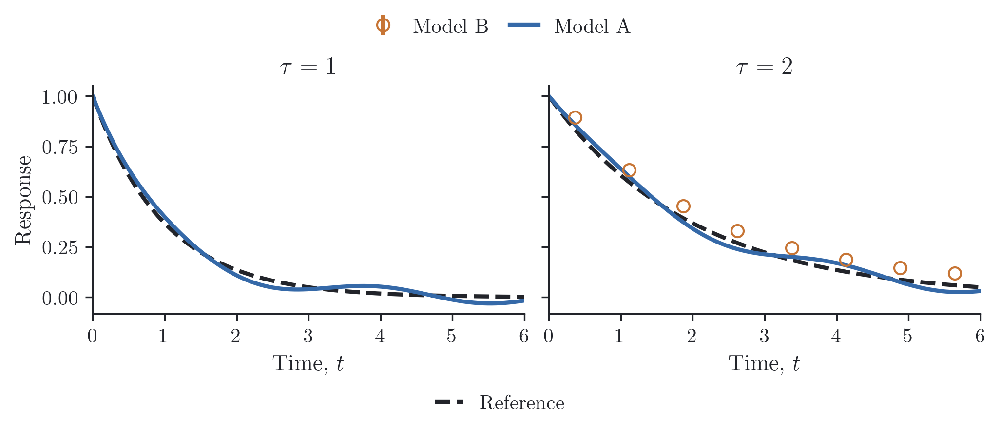
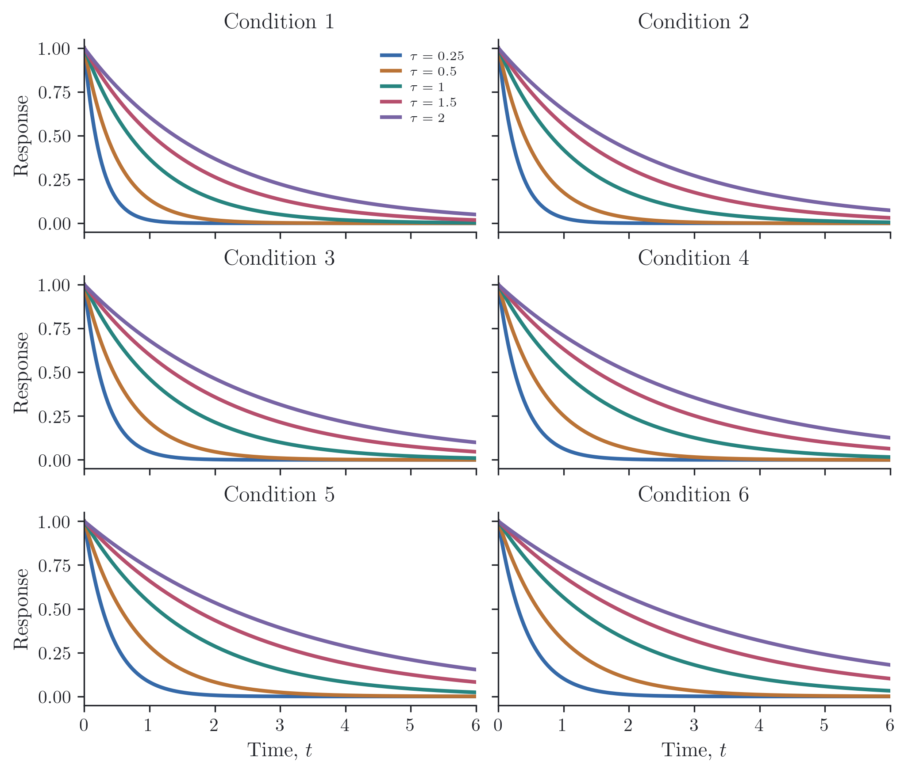

# reiplotlib

Reiplotlib is a collection of Matplotlib utilities, styles, and slightly opinionated presets for consistent, publication-ready figures.

Part of **Reiko Studio**.


## Installation

```bash
pip install git+https://github.com/reiko-studio/reiplotlib.git
```

You will need Python ≥3.10 and Matplotlib ≥3.7. The default style uses LaTeX,
so a distribution such as [TeX Live](https://www.tug.org/texlive/),
[MacTeX](https://www.tug.org/mactex/), or [MiKTeX](https://miktex.org/) should also
be installed. If it is not available and/or you prefer Matplotlib's own text rendering, set
`text.usetex` to `False` in the style context below.

## A first figure

We can start with a few damped oscillations. Most of this is ordinary Matplotlib:
reiplotlib sets the style and figure size, and each line takes its next color
from the Grove palette.

```python
import numpy as np
import reiplotlib as rpl
from reiplotlib import layouts as layout

x = np.linspace(0, 12, 400)

with rpl.rc_context({"text.usetex": True}):
    fig, ax = layout.subplots(width="single", aspect=0.75, layout="constrained")
    for tau in (1.5, 3.0, 6.0):
        y = np.exp(-x / tau) * np.cos(2 * np.pi * x / 4)
        ax.plot(x, y, label=rf"$\tau={tau:g}$")
    ax.set(xlim=(0, 12), xlabel=r"Time, $t$",
           ylabel=r"Response, $C(t)$")
    rpl.clean_axes(ax, grid=False)
    rpl.clean_legend(ax)
    rpl.export.savefig(fig, "figures/response")
```


By default, the figure is saved as both PNG `figures/response.png` and PDF `figures/response.pdf`, 
this is to make it simple to import a vectorize version into LaTeX and a rasterized version 
for a slide deck. 

Keeping the work inside `rc_context()` lets us use the style for this figure
without changing the rest of the session. For a script where every figure should
look the same, `rpl.apply_style()` applies it once at the beginning.

## Palettes


Reiplotlib has a few curated palettes, grove is the default, but a different palette can give the same figure a rather different character. Set it on the axes before drawing the lines:

```python
from reiplotlib import palettes as p

rpl.use_palette(ax, p.myth)
ax.plot(x, y)
```


Individual colors are available too: `p.grove[0]` is the first color, and
`p.get("grove")` retrieves the palette by name. These are ordinary color strings,
so they can be used anywhere Matplotlib expects a color. Once a cycle runs out,
it starts again; for many curves, different markers or line styles help.

Paper combines ink and gray with teal, burgundy, gold, and green. Myth draws on
[Hololive Myth's](https://hololive.hololivepro.com/en/talents?gp=myth) member colors, adapted for plotting .
Contrast and Duo offer smaller sets.
[Tol Bright](https://sronpersonalpages.nl/~pault/#sec:qualitative) uses Paul Tol's
seven published colors and recommended order.

## Named colors

Sometimes a curve needs a particular color, or a shaded region needs to belong
to the same family as its outline. The named colors give us a few shades to
choose from:

```python
from reiplotlib import colors as c

ax.plot(x, y, color=c.red)
ax.plot(x, y_reference, color=c.blue.dark)
ax.fill_between(x, lo, hi, color=c.red.pale)
```


`c.red` is shorthand for the base color. The darker shades work well for lines
and outlines, while the light and pale shades leave room for other information
when used as fills. Each family has `.dark`, `.base`, `.bright`, `.light`, and
`.pale`; these shades are chosen individually.
For lookup by name, use `c.named["red.dark"]` or browse `c.families`.

### Your own color

If you already have a color in mind, `NamedColor` can suggest a family around it.
The generated shades are a starting point, and any of them can be adjusted:

```python
custom = rpl.NamedColor("#467A9B")
custom.dark = "#233F59"  # Override one generated shade.

with rpl.rc_context({"text.usetex": True}):
    fig, ax = layout.subplots(width="single", aspect=0.65, layout="constrained")
    x = np.linspace(0, 6, 200)
    y = np.exp(-x / 2)
    ax.fill_between(x, 0, y, color=custom.pale)
    ax.plot(x, y, color=custom, label=r"$e^{-t/2}$")
    ax.plot(x, 0.8 * y, color=custom.dark, ls="--", label=r"$0.8e^{-t/2}$")
    ax.set(xlabel=r"Time, $t$", ylabel="Response", xlim=(0, 6), ylim=(0, 1.05))
    rpl.clean_axes(ax, grid=False)
    rpl.clean_legend(ax)
    rpl.export.savefig(fig, "figures/custom-color")
```


Starting from a `#RGB` or `#RRGGBB` value, the darker shade mixes in 35% black;
the light and pale shades mix in 55% and 85% white in sRGB. The bright shade
increases HLS saturation and lightness toward their maxima by 25% and 10%.
This is a simple approximation, so some starting colors will need more
adjustment than others.

Changing `custom.base` generates a fresh family, so make any individual shade
adjustments afterward. `custom` itself works as a Matplotlib color, while
`custom.base` gives its hex string. To recolor a line that has already been
drawn, use `line.set_color(custom.base)`.

### Neutrals

For text and the quieter parts of a figure, there is a small neutral family:


```python
from reiplotlib import colors as c

ax.axhline(0, color=c.neutral.muted, linestyle=":")
ax.set_facecolor(c.neutral.paper)
ax.set_title("Response", color=c.neutral.ink)
```

The default style uses `ink` for text and outlines, `white` for the background,
and `grid` for gridlines. `muted` is useful for reference lines and secondary
annotations; `paper` gives a slightly warmer background when pure white feels
too stark.

## Size and style

Journal figures need to fit the manuscript's columns while keeping their labels
readable alongside the surrounding text. Resizing a finished plot also scales
its fonts, markers, and line widths, so a figure that looked balanced on screen
may feel quite different on the page. Starting at the intended size makes these
choices easier to judge and leaves less to adjust when inserting the figure.

Reiplotlib provides column widths through the `journal` argument to
`layouts.subplots()`. Choose a single- or double-column figure and set its
height with `aspect`, the ratio of height to width. PRL (`journal="prl"`) is
the current preset; more journal sizes are planned.


```python
from reiplotlib import layouts as layout

fig, ax = layout.subplots(journal="prl", width="single", aspect=0.75)
fig, axs = layout.subplots(1, 2, journal="prl", width="double", aspect=0.45)
fig, ax = layout.subplots(figsize=(3.3, 3.0))
```

For the PRL preset, the widths are 243 TeX points (3.36 inches) for a single
column and 486 points (6.72 inches) for two columns. The size applies to the
whole figure, including all panels. In the sketches above, the outer rectangles
share a common scale and the dashed boxes indicate the plot areas.

You can also supply `figsize` directly, which takes precedence over the preset.
If you prefer creating axes with `plt.subplots()`,
`layout.size("single", journal="prl", aspect=0.75)` returns the corresponding
dimensions in inches. These describe the figure canvas; tight cropping can
change the saved bounds, so pass `bbox_inches=None` when exporting to preserve
the exact dimensions.

The option presets are already curated to choose line widths, marker and scatter sizes, 
error-bar caps, and fill opacity with paper figures in mind. You can use them as they are,
without tuning each element separately:

```python
from reiplotlib import options as o

ax.plot(x, y, **o.line())
ax.scatter(x, y, **o.scatter())
ax.fill_between(x, lo, hi, **o.fill())
```

They return ordinary keyword dictionaries, so an occasional adjustment is still
easy: `o.line(linewidth=1.2, linestyle="--")`. Without a color argument,
Matplotlib chooses from the axes' palette. You can still choose one explicitly,
as in `o.line(c.blue)`. Lines and fills follow Matplotlib's separate cycles;
use `rpl.shade()` when a band should match the line you just drew.

For a lighter frame, `rpl.clean_axes(ax, grid=False)` removes the top and right
spines while keeping the ticks. `rpl.clean_legend(ax)` gathers labeled artists
into a compact legend. Panel labels can be added with `rpl.label_panel(ax, "A")`,
and fractions can be displayed as percentages with `rpl.percent_axis(ax, axis="y")`.

## A figure with two panels

For related plots, we can give each panel its own label while keeping the
colors and horizontal scale in common. Here the same three timescales appear
as a relaxation curve on the left and its accumulated response on the right:

```python
from reiplotlib import options as o

with rpl.rc_context({"text.usetex": True}):
    fig, axes = layout.subplots(1, 2, width="double", aspect=0.40,
                               layout="constrained", sharex=True)
    x = np.linspace(0, 6, 200)
    for tau in (0.5, 1.0, 2.0):
        y = np.exp(-x / tau)
        axes[0].plot(x, y, label=rf"$\tau={tau:g}$", **o.line())
        axes[1].plot(x, tau * (1 - y), **o.line())

    for ax, label in zip(axes, ("(a)", "(b)")):
        ax.set(xlabel=r"Time, $t$", xlim=(0, 6))
        rpl.clean_axes(ax, grid=False)
        rpl.label_panel(ax, label, x=0.03, y=0.96)
    axes[0].set_ylabel(r"$C(t)=e^{-t/\tau}$")
    axes[1].set_ylabel(r"$\int_0^t C(s)\,\mathrm{d}s$")
    handles, labels = axes[0].get_legend_handles_labels()
    fig.legend(handles, labels, loc="outside upper center", ncols=3)
    rpl.export.savefig(fig, "figures/panels")
```


Each axes starts with the same color cycle, so plotting the timescales in the
same order keeps their colors consistent. `label_panel()` places text in axes
coordinates; adjust `x` and `y` to move a label inside or outside its panel.

## Keeping series consistent

When panels contain different subsets of the data, a color cycle can give the
same curve a different appearance in each panel. We can instead assign a style
to each series once and reuse it by name:

```python
styles = {
    "fast": rpl.SeriesStyle(color=rpl.colors.blue, marker="o", linestyle="-",
                            markerfacecolor="none", label=r"$\tau=0.5$"),
    "medium": rpl.SeriesStyle(color=rpl.colors.orange, marker="s", linestyle="--",
                              markerfacecolor="none", label=r"$\tau=1$"),
    "slow": rpl.SeriesStyle(color=rpl.colors.teal, marker="^", linestyle="-.",
                            markerfacecolor="none", label=r"$\tau=2$"),
}
timescales = {"fast": 0.5, "medium": 1.0, "slow": 2.0}

with rpl.rc_context({"text.usetex": True}):
    fig, axes = layout.subplots(1, 2, width="double", aspect=0.40,
                               layout="constrained", sharex=True, sharey=True)
    x = np.linspace(0, 6, 200)
    for ax, order in zip(axes, (("fast", "medium", "slow"), ("slow", "fast"))):
        for key in order:
            style = styles[key]
            y = np.exp(-x / timescales[key])
            ax.plot(x, y, **style.line(markevery=28))
        ax.set(xlabel=r"Time, $t$", xlim=(0, 6))
        rpl.clean_axes(ax, grid=False)
    axes[0].set(title="All series", ylabel="Response")
    axes[1].set_title("Reordered subset")
    fig.legend(handles=[style.legend_handle() for style in styles.values()],
               loc="outside upper center", ncols=3)
    rpl.export.savefig(fig, "figures/series-styles")
```


The second panel draws the slow curve first and leaves out the middle curve,
but both remaining curves keep their colors, markers, and line styles. The
styles live in an ordinary dictionary, so a misspelled key raises `KeyError`.

`style.line()` and `style.errorbar()` return plotting options without a label;
pass `label=style.label` for an axes legend, or use `style.legend_handle()` for
a separate legend as above. Overrides such as `style.line(markersize=5)` affect
only that call. The same style also works with uncertainties:

```python
style = styles["slow"]
rpl.errorbar(ax, x, y, yerr=se, label=style.label, **style.errorbar())
```

## Shared legends

A figure often has the same curve in several panels, but only needs one legend
entry for it. `figure_legend()` gathers the labels across the axes and combines
matching entries. We can also give references and model curves their own groups:

```python
with rpl.rc_context({"text.usetex": True}):
    fig, axes = layout.subplots(1, 2, width="double", aspect=0.43,
                               layout="constrained", sharex=True, sharey=True)
    x = np.linspace(0, 6, 200)
    for ax, tau in zip(axes, (1.0, 2.0)):
        y = np.exp(-x / tau)
        ax.plot(x, y, color=rpl.colors.neutral.ink, ls="--", label="Reference")
        ax.plot(x, y + 0.035 * np.sin(2 * x), color=rpl.colors.blue,
                label="Model A")
        ax.set(title=rf"$\tau={tau:g}$", xlabel=r"Time, $t$", xlim=(0, 6))
        rpl.clean_axes(ax, grid=False)
    rpl.errorbar(axes[1], x[12::25], np.exp(-x[12::25] / 2) + 0.06,
                 yerr=0.025, color=rpl.colors.orange, marker="o",
                 markerfacecolor="none", ls="none", label="Model B")
    axes[0].set_ylabel("Response")

    rpl.figure_legend(fig, axes, include=["Model A", "Model B"],
                      order=["Model B", "Model A"], group="models", ncols=2,
                      loc="outside upper center")
    rpl.figure_legend(fig, axes, include=["Reference"], group="references",
                      loc="outside lower center")
    rpl.export.savefig(fig, "figures/shared-legends")
```



Model B appears only in the right panel, but still belongs to the shared legend.
`include` selects entries by their labels; `order` brings the listed labels to
the front. Giving each legend a `group` lets us update it later without removing
the other groups. Repeating a call replaces that group rather than adding a
second copy. Constrained layout leaves room for the outside positions shown
here; other layouts may need their margins adjusted.

By default, repeated labels must have matching styles. If two panels use the
same label for different styles, choose distinct labels or explicitly select a
duplicate policy with `duplicates="first"` or `"last"`. Missing labels in
`include` or `order` raise `KeyError`, making typos easier to catch.

For more control, `rpl.collect_legend(axes)` returns a label-to-handle dictionary
without drawing anything. Pass that dictionary, or your own proxy handles, as
`rpl.figure_legend(fig, entries=entries)`. The drawing helper returns the
Matplotlib legend, so its title and other properties can still be adjusted.

### A shared legend inside one panel

If the same curves appear throughout a grid, the first panel can hold the legend
for all of them. Give `axes_legend()` the destination panel and the axes to
collect from:

```python
with rpl.rc_context({"text.usetex": True}):
    fig, axes = layout.subplots(3, 2, width="double", aspect=0.85,
                               layout="constrained", sharex=True, sharey=True)
    x = np.linspace(0, 6, 200)
    for panel, ax in enumerate(axes.flat):
        for tau in (0.25, 0.5, 1.0, 1.5, 2.0):
            y = np.exp(-x / (tau * (1 + 0.15 * panel)))
            ax.plot(x, y, label=rf"$\tau={tau:g}$")
        ax.set(title=f"Condition {panel + 1}", xlim=(0, 6))
        rpl.clean_axes(ax, grid=False)
    for ax in axes[-1]:
        ax.set_xlabel(r"Time, $t$")
    for ax in axes[:, 0]:
        ax.set_ylabel("Response")

    rpl.axes_legend(axes[0, 0], axes, loc="upper right", fontsize=7)
    rpl.export.savefig(fig, "figures/panel-legend")
```



Only the first panel gets a legend. The same `include` and `order` arguments
work here, so you can gather just the repeated methods there and keep a separate
reference entry in another panel. Omitting the second argument collects from
all panels in the destination's figure. Other panels' existing legends are left
alone; calling the helper again replaces the destination panel's legend.

## Error bars and limits

### Shaded bands

Once a line is drawn, `shade()` can add a band using the same color. A single
width gives a symmetric band; separate lower and upper widths allow it to be
asymmetric:

```python
with rpl.rc_context({"text.usetex": True}):
    fig, axes = layout.subplots(1, 2, width="double", aspect=0.38,
                               layout="constrained", sharey=True)
    x = np.linspace(0, 6, 200)
    y = np.exp(-x / 2)
    std = 0.025 + 0.05 * y

    axes[0].plot(x, y)
    rpl.shade(axes[0], x, y, std)
    axes[0].set_title(r"Symmetric: $y\pm\sigma$")

    axes[1].plot(x, y)
    rpl.shade(axes[1], x, y, (0.5 * std, 1.8 * std))
    axes[1].set_title("Asymmetric")

    for ax in axes:
        ax.set(xlabel=r"Time, $t$", xlim=(0, 6))
        rpl.clean_axes(ax, grid=False)
    axes[0].set_ylabel("Response")
    rpl.export.savefig(fig, "figures/shading")
```


`yerr` accepts a scalar, an array of symmetric widths, or a `(2, N)` array of
lower and upper widths. Widths are nonnegative distances from `y`, not absolute
bounds; pass whichever standard deviations or interval widths you computed.
`shade()` returns the filled artist and forwards options such as `alpha`,
`where`, `step`, and `label` to Matplotlib's `fill_between()`.

### Error bars

Small error bars can clutter a figure when their caps are wider than the
uncertainty itself. `rpl.errorbar()` can hide bars that fit inside their markers.
Hollow markers make the difference easier to see:

```python
from reiplotlib import options as o

with rpl.rc_context({"text.usetex": True}):
    fig, axes = layout.subplots(1, 2, width="double", aspect=0.40,
                               layout="constrained", sharex=True, sharey=True)
    x = np.arange(1, 9)
    y = 0.55 + 0.12 * np.sin(0.8 * x)
    se = np.array([0.001, 0.003, 0.012, 0.045, 0.080, 0.006, 0.025, 0.002])

    for ax, hide, title in zip(axes, (True, False),
                               ("Adaptive hiding", "All error bars")):
        rpl.errorbar(ax, x, y, yerr=se, hide_small_errors=hide,
                     **o.errorbar(rpl.colors.blue, markersize=7,
                                  markerfacecolor="none", markeredgewidth=1.2,
                                  capsize=3, elinewidth=0.9))
        ax.set(title=title, xlabel=r"Sample, $i$", xlim=(0.5, 8.5),
               ylim=(0.30, 0.82), xticks=[2, 4, 6, 8])
        rpl.clean_axes(ax, grid=False)
    axes[0].set_ylabel(r"Estimate, $y_i$")
    rpl.export.savefig(fig, "figures/errorbars")
```


Both panels use the same estimates and uncertainties. Hollow markers make small
bars visible in the right panel; adaptive hiding removes those shorter than the
marker diameter on the left.

Bars smaller than their markers are hidden individually and reappear when a zoom
or resize makes them visible. Caps follow their bars; the uncertainty values and
autoscaling bounds remain intact. Set `hide_small_errors=False` to show every
bar. Polar axes and one-sided limit arrows require this opt-out. Inputs are fixed
at creation; recreate the artist to change the data.

### Visible limits

When we zoom into the tail of a curve, an earlier peak can leave a lot of empty
space on the y axis. Setting the x limits does not recalculate that range;
`autoscale_y()` fits it to the part of the curve still in view:

```python
with rpl.rc_context({"text.usetex": True}):
    fig, axes = layout.subplots(1, 2, width="double", aspect=0.38,
                               layout="constrained")
    x = np.linspace(0, 10, 400)
    y = 8 * np.exp(-x) + 0.15 * np.sin(3 * x)

    for ax in axes:
        ax.plot(x, y)
        ax.set(xlim=(4, 10), xlabel=r"Time, $t$")
        rpl.clean_axes(ax, grid=False)
    axes[0].set(title="Default y limits", ylabel="Response")
    axes[1].set_title("Visible-range y limits")
    rpl.autoscale_y(axes[1], margin=0.08)
    rpl.export.savefig(fig, "figures/autoscale")
```


The large initial peak is outside both panels. Fitting the y limits to the
visible data reveals the small oscillations without changing the curve.

Shared-y panels combine their visible ranges, including error bars and crossing
line segments. Manual y limits are preserved unless `override=True`. Lines,
scatter, and line collections are supported; images and filled bands are not.
Use `watch=True` to update on x-limit changes; the returned `(axes, callback_id)`
pairs can be disconnected with `axes.callbacks.disconnect(callback_id)`.

## Export

```python
rpl.export.savefig(fig, "figures/response")                 # PNG + PDF, 300 dpi
rpl.export.savefig(fig, "figures/draft", formats=("png",))  # PNG only
rpl.export.saveclose(fig, "figures/response")               # Save and close
```

The export helper creates the output directory if needed. Keep the save call
inside the style context so LaTeX and the other settings are still active when
the figure is rendered. Matplotlib's usual save options also work here, including
`transparent=True` and `bbox_inches=None`.

[MIT license](LICENSE).
