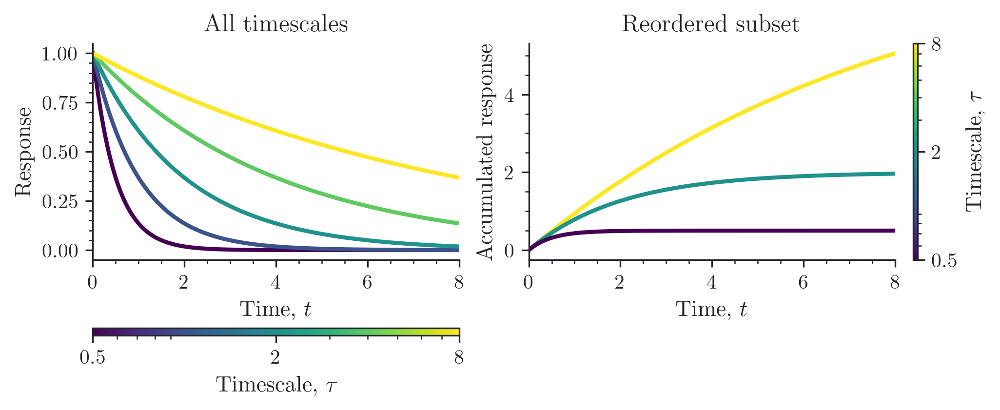
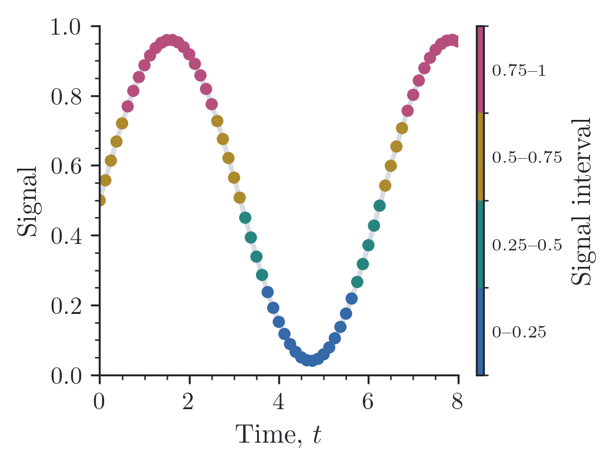
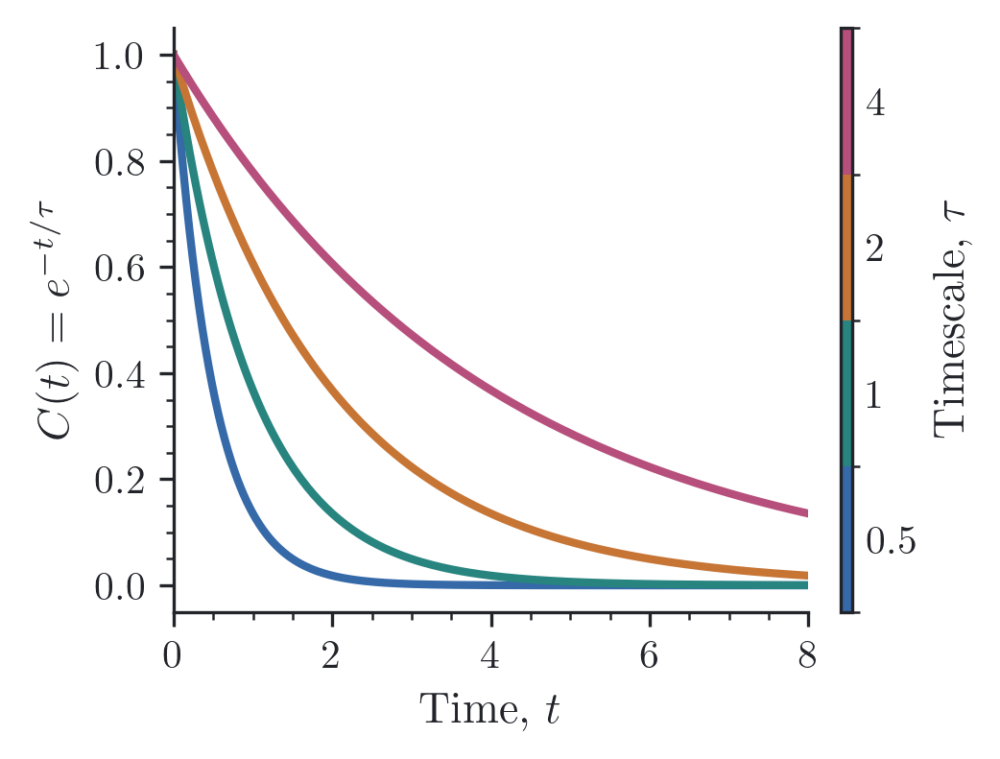

# Numeric color scales

When a color represents a temperature, frequency, or timescale, it helps to keep
the mapping fixed across the whole figure. `ColorScale` pairs a colormap with a
numerical range and uses the same mapping for its colorbar. Here the second panel
shows only a subset of the timescales, in reverse order:

```python
import numpy as np
import reiplotlib as rpl
from reiplotlib import layouts as layout

from matplotlib.colors import LogNorm

scale = rpl.ColorScale("viridis", norm=LogNorm(vmin=0.5, vmax=8))

with rpl.rc_context({"text.usetex": True}):
    fig, axes = layout.subplots(1, 2, width="double", aspect=0.40,
                               layout="constrained", sharex=True)
    x = np.linspace(0, 8, 200)
    for tau in (0.5, 1, 2, 4, 8):
        axes[0].plot(x, np.exp(-x / tau), color=scale(tau))
    for tau in (8, 2, 0.5):
        axes[1].plot(x, tau * (1 - np.exp(-x / tau)), color=scale(tau))
    axes[0].set(title="All timescales", ylabel="Response")
    axes[1].set(title="Reordered subset", ylabel="Accumulated response")
    for ax in axes:
        ax.set(xlabel=r"Time, $t$", xlim=(0, 8))
        rpl.clean_axes(ax, grid=False)
    scale.colorbar(axes[0], label=r"Timescale, $\tau$", ticks=[0.5, 2, 8],
                   format="%g", orientation="horizontal")
    scale.colorbar(axes[1], label=r"Timescale, $\tau$", ticks=[0.5, 2, 8],
                   format="%g", orientation="vertical")
    rpl.export.savefig(fig, "figures/color-scale")
```

{ width="720" }

For a linear scale, `rpl.ColorScale("viridis", vmin=0, vmax=300)` is enough.
The default range is 0 to 1. A supplied `norm` must already have its bounds set,
so the colors never depend on which subset happens to be drawn first.
`scale(values)` also accepts arrays, and `scale.mappable` works with Matplotlib's
own colorbar API. Pass `cax=` to `scale.colorbar()` for manual placement, or
`orientation="horizontal"` to put the scale below a group of axes.

Colorbars are thin by default in both orientations: the long side is 50 times
the thickness. Adjust `aspect` for a thicker or thinner bar, `fraction` for the
space it may occupy, and `pad` for the gap from the plot. For example,
`scale.colorbar(ax, aspect=30)` gives a thicker bar. An explicit `cax` keeps its
own dimensions. The same preset is available for ordinary Matplotlib calls:

```python
from reiplotlib import options as o

fig.colorbar(scale.mappable, ax=ax, **o.colorbar())
```

### Discrete bins

Sometimes the useful distinction is between ranges of values rather than each
individual value. `BoundaryNorm` assigns one color to each interval; a
`ListedColormap` lets us choose those colors ourselves. Here the points fall
into four bands of a measured signal:

```python
from matplotlib.colors import BoundaryNorm, ListedColormap

edges = [0, 0.25, 0.5, 0.75, 1]
cmap = ListedColormap([rpl.colors.blue, rpl.colors.teal,
                       rpl.colors.gold, rpl.colors.pink])
bins = rpl.ColorScale(cmap, norm=BoundaryNorm(edges, cmap.N))

with rpl.rc_context({"text.usetex": True}):
    fig, ax = layout.subplots(width="single", aspect=0.75, layout="constrained")
    x = np.linspace(0, 8, 65)
    y = 0.5 + 0.46 * np.sin(x)
    ax.plot(x, y, color=rpl.colors.neutral.grid, zorder=1)
    ax.scatter(x, y, color=bins(y), s=16, zorder=2)
    ax.set(xlabel=r"Time, $t$", ylabel="Signal", xlim=(0, 8), ylim=(0, 1))
    rpl.clean_axes(ax, grid=False)
    cb = bins.colorbar(ax, orientation="vertical",
                       ticks=[0.125, 0.375, 0.625, 0.875], label="Signal interval")
    cb.set_ticklabels([r"$0$--$0.25$", r"$0.25$--$0.5$",
                       r"$0.5$--$0.75$", r"$0.75$--$1$"])
    cb.ax.tick_params(labelsize=7, length=0)
    rpl.export.savefig(fig, "figures/discrete-bins")
```

{ width="360" }

The edges define the bins, while the ticks sit at their centers. An interior
edge belongs to the bin above it; the last edge and values above it use the
colormap's over color, which defaults to its last color.

Masks and NaNs take the colormap's bad color, usually transparent. Values outside
the range use its endpoint or configured under/over colors; clipping follows the
chosen norm. The norm and colormap remain ordinary Matplotlib objects, so these
choices can be adjusted without changing the plotting calls.

### A colorbar in place of a legend

For a few curves indexed by a numerical parameter, a discrete colorbar can carry
the parameter values instead of a legend. Each timescale below gets its own
color, with the tick centered on that color's block:

```python
from matplotlib.colors import BoundaryNorm, ListedColormap

taus = np.array([0.5, 1.0, 2.0, 4.0])
edges = np.array([0.25, 0.75, 1.5, 3.0, 5.0])
cmap = ListedColormap([rpl.colors.blue, rpl.colors.teal,
                       rpl.colors.orange, rpl.colors.pink])
scale = rpl.ColorScale(cmap, norm=BoundaryNorm(edges, cmap.N))

with rpl.rc_context({"text.usetex": True}):
    fig, ax = layout.subplots(width="single", aspect=0.75, layout="constrained")
    x = np.linspace(0, 8, 200)
    for tau in taus:
        ax.plot(x, np.exp(-x / tau), color=scale(tau))
    ax.set(xlabel=r"Time, $t$", ylabel=r"$C(t)=e^{-t/\tau}$", xlim=(0, 8))
    rpl.clean_axes(ax, grid=False)
    centers = (edges[:-1] + edges[1:]) / 2
    cb = scale.colorbar(ax, orientation="vertical", ticks=centers,
                        spacing="uniform", label=r"Timescale, $\tau$")
    cb.set_ticklabels([f"{tau:g}" for tau in taus])
    cb.ax.tick_params(length=0)
    rpl.export.savefig(fig, "figures/decay-colorbar")
```

{ width="360" }

The block labels identify the four chosen timescales. `spacing="uniform"` gives
each block equal space, even though the timescales are not evenly separated.
The bin edges serve only to assign a color to each curve; this bar is a key to
the sampled values rather than a continuous scale.
