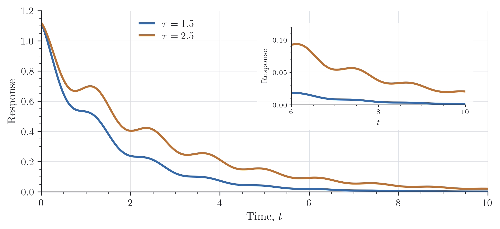
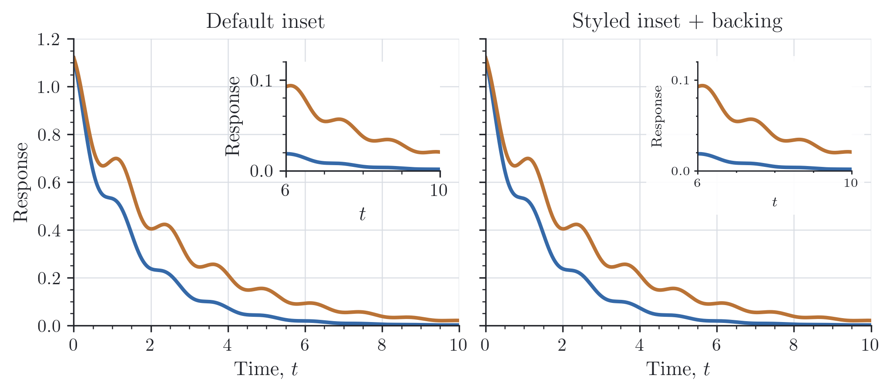

# Insets

An inset can show the small feature that would otherwise disappear inside the
full range of a plot. Place it with Matplotlib's `ax.inset_axes()`, then use
`style_inset()` to give its labels and ticks a more compact size.

Here the inset follows the late-time tail of the same curves. A translucent
backing keeps the parent grid from running through its labels:

```python
import numpy as np
import reiplotlib as rpl
from reiplotlib import layouts as layout

with rpl.rc_context({"text.usetex": True}):
    fig, ax = layout.subplots(width="double", aspect=0.45, layout="constrained")
    t = np.linspace(0, 10, 500)
    inset = ax.inset_axes([0.56, 0.48, 0.39, 0.43])
    for tau in (1.5, 2.5):
        response = np.exp(-t / tau) * (1 + 0.12 * np.cos(5 * t))
        ax.plot(t, response, label=rf"$\tau={tau:g}$")
        inset.plot(t, response)

    ax.set(xlim=(0, 10), ylim=(0, 1.2), xlabel=r"Time, $t$", ylabel="Response")
    inset.set(xlim=(6, 10), ylim=(0, 0.12), xlabel=r"$t$", ylabel="Response",
              xticks=[6, 8, 10], yticks=[0, 0.05, 0.10])
    rpl.clean_axes(ax)
    rpl.clean_axes(inset, grid=False)
    rpl.clean_legend(ax, loc="upper left", bbox_to_anchor=(0.20, 1))
    rpl.style_inset(inset)
    inset.set_facecolor("none")
    backing = rpl.inset_backing(inset, pad=4, alpha=0.92)
    rpl.export.savefig(fig, "figures/insets")
```

{ width="720" }

The backing covers the inset's rendered bounds, including its tick labels, axis
labels, and title. `pad` adds space in points. It follows changes to those labels
and the figure size, including during PNG and PDF export.

Its color and opacity are independent of the inset's own facecolor. Leaving the
usual white facecolor keeps the plot area opaque; `set_facecolor("none")`, as
above, lets the backing show through it too. You can style the returned rectangle
with ordinary Matplotlib methods, for example `backing.set_facecolor(...)`, or
remove it with `backing.remove()`.

The same inset is shown below before and after applying the compact style and
adding a backing. Both panels use the same data, inset position, and parent
style; the smaller labels and shorter ticks leave more room around the detail,
while the backing separates its labels from the parent grid.

{ width="720" }

`style_inset(inset, labelsize=8, ticksize=7, linewidth=0.7, ticklength=2)` exposes
the compact defaults. It keeps your placement, limits, colors, grid, and visible
spines. Both helpers also work on an existing inset; neither chooses which data
to show or adds zoom connectors.

Calling `inset_backing()` again replaces the old backing. Hiding or removing the
inset also hides its backing; when discarding an inset, remove both artists.
There are no callbacks to disconnect. For figure-level insets created with
`fig.add_axes()`, put the inset above the main axes with an appropriate `zorder`
so its backing can sit immediately below it.
