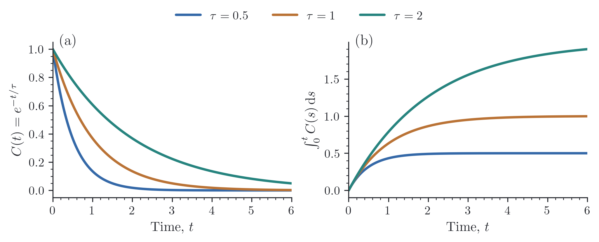

# A figure with two panels

For related plots, we can give each panel its own label while keeping the
colors and horizontal scale in common. Here the same three timescales appear
as a relaxation curve on the left and its accumulated response on the right:

```python
import numpy as np
import reiplotlib as rpl
from reiplotlib import layouts as layout

from reiplotlib import options as o

with rpl.rc_context({"text.usetex": True}):
    fig, axes = layout.subplots(1, 2, width="double", aspect=0.40,
                               layout="constrained", sharex=True)
    x = np.linspace(0, 6, 200)
    for tau in (0.5, 1.0, 2.0):
        y = np.exp(-x / tau)
        axes[0].plot(x, y, label=rf"$\tau={tau:g}$", **o.line())
        axes[1].plot(x, tau * (1 - y), **o.line())

    for ax, label in zip(axes, ("(a)", "(b)")):
        ax.set(xlabel=r"Time, $t$", xlim=(0, 6))
        rpl.clean_axes(ax, grid=False)
        rpl.label_panel(ax, label, x=0.03, y=0.96)
    axes[0].set_ylabel(r"$C(t)=e^{-t/\tau}$")
    axes[1].set_ylabel(r"$\int_0^t C(s)\,\mathrm{d}s$")
    handles, labels = axes[0].get_legend_handles_labels()
    fig.legend(handles, labels, loc="outside upper center", ncols=3)
    rpl.export.savefig(fig, "figures/panels")
```

{ width="720" }

Each axes starts with the same color cycle, so plotting the timescales in the
same order keeps their colors consistent. `label_panel()` places text in axes
coordinates; adjust `x` and `y` to move a label inside or outside its panel.
