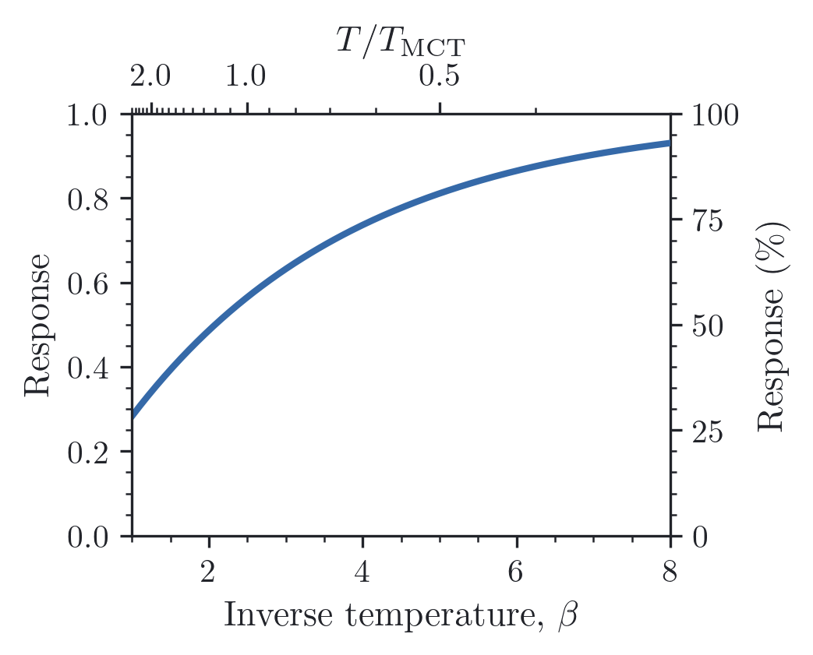

# Secondary axes

Sometimes the same coordinate is easier to read in two units. A secondary axis
keeps those views together: give it the forward and inverse conversions, then
choose any ticks you want in the new units.

Here the top axis converts inverse temperature to $T/T_{\mathrm{MCT}}$, while
the right axis shows the response as a percentage:

```python
import numpy as np
import reiplotlib as rpl
from reiplotlib import layouts as layout

T_MCT = 0.4


def temperature_ratio(values):
    # Matplotlib may evaluate the transform outside the plotted interval.
    with np.errstate(divide="ignore", invalid="ignore"):
        return 1 / (T_MCT * np.asarray(values, dtype=float))


with rpl.rc_context({"text.usetex": True}):
    fig, ax = layout.subplots(width="single", aspect=0.80, layout="constrained")
    beta = np.linspace(1, 8, 200)
    ax.plot(beta, 1 - np.exp(-beta / 3))
    ax.set(xlim=(1, 8), ylim=(0, 1), xlabel=r"Inverse temperature, $\beta$",
           ylabel="Response")
    rpl.clean_axes(ax, grid=False)

    top = rpl.secondary_xaxis(
        ax, functions=(temperature_ratio, temperature_ratio),
        ticks=[0.25, 0.5, 1, 2, 3], label=r"$T/T_{\mathrm{MCT}}$",
    )
    right = rpl.secondary_yaxis(
        ax, functions=(lambda y: 100 * y, lambda y: y / 100),
        ticks=[0, 25, 50, 75, 100], label=r"Response (\%)",
    )
    rpl.export.savefig(fig, "figures/secondary-axes")
```

{ width="360" }

Explicit ticks follow the visible range when you zoom, including inverted axes;
their labels stay attached to the corresponding values. Pass `labels=[...]` for
custom tick text, or leave out `ticks` to use Matplotlib's automatic ticks.
`labelsize` and `ticksize` adjust the typography if needed. Both helpers return a
Matplotlib secondary axis, so `top.set_xlabel(...)` or `right.remove()` work as
usual. The conversions should accept arrays and be invertible over the plotted
range; any domain restrictions belong in those functions.

For two independently plotted quantities, Matplotlib's `ax.twinx()` is still the
appropriate choice: a secondary axis expresses the same coordinate in new units.

