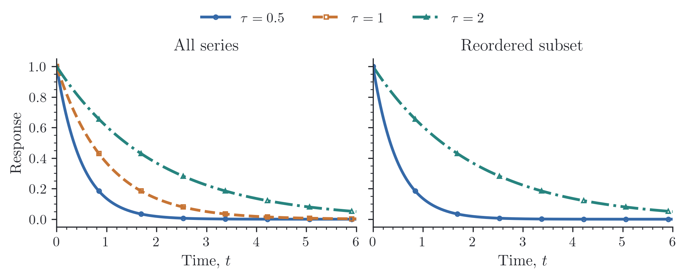

# Keeping series consistent

When panels contain different subsets of the data, a color cycle can give the
same curve a different appearance in each panel. We can instead assign a style
to each series once and reuse it by name:

```python
import numpy as np
import reiplotlib as rpl
from reiplotlib import layouts as layout

styles = {
    "fast": rpl.SeriesStyle(color=rpl.colors.blue, marker="o", linestyle="-",
                            markerfacecolor="none", label=r"$\tau=0.5$"),
    "medium": rpl.SeriesStyle(color=rpl.colors.orange, marker="s", linestyle="--",
                              markerfacecolor="none", label=r"$\tau=1$"),
    "slow": rpl.SeriesStyle(color=rpl.colors.teal, marker="^", linestyle="-.",
                            markerfacecolor="none", label=r"$\tau=2$"),
}
timescales = {"fast": 0.5, "medium": 1.0, "slow": 2.0}

with rpl.rc_context({"text.usetex": True}):
    fig, axes = layout.subplots(1, 2, width="double", aspect=0.40,
                               layout="constrained", sharex=True, sharey=True)
    x = np.linspace(0, 6, 200)
    for ax, order in zip(axes, (("fast", "medium", "slow"), ("slow", "fast"))):
        for key in order:
            style = styles[key]
            y = np.exp(-x / timescales[key])
            ax.plot(x, y, **style.line(markevery=28))
        ax.set(xlabel=r"Time, $t$", xlim=(0, 6))
        rpl.clean_axes(ax, grid=False)
    axes[0].set(title="All series", ylabel="Response")
    axes[1].set_title("Reordered subset")
    fig.legend(handles=[style.legend_handle() for style in styles.values()],
               loc="outside upper center", ncols=3)
    rpl.export.savefig(fig, "figures/series-styles")
```

{ width="720" }

The second panel draws the slow curve first and leaves out the middle curve,
but both remaining curves keep their colors, markers, and line styles. The
styles live in an ordinary dictionary, so a misspelled key raises `KeyError`.

`style.line()` and `style.errorbar()` return plotting options without a label;
pass `label=style.label` for an axes legend, or use `style.legend_handle()` for
a separate legend as above. Overrides such as `style.line(markersize=5)` affect
only that call. The same style also works with uncertainties:

```python
style = styles["slow"]
rpl.errorbar(ax, x, y, yerr=se, label=style.label, **style.errorbar())
```
