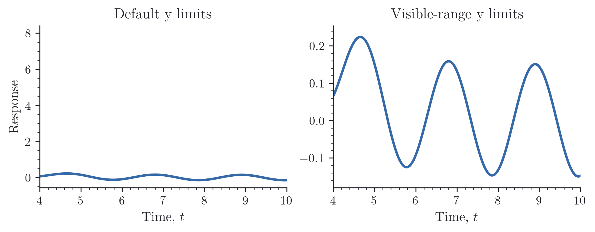
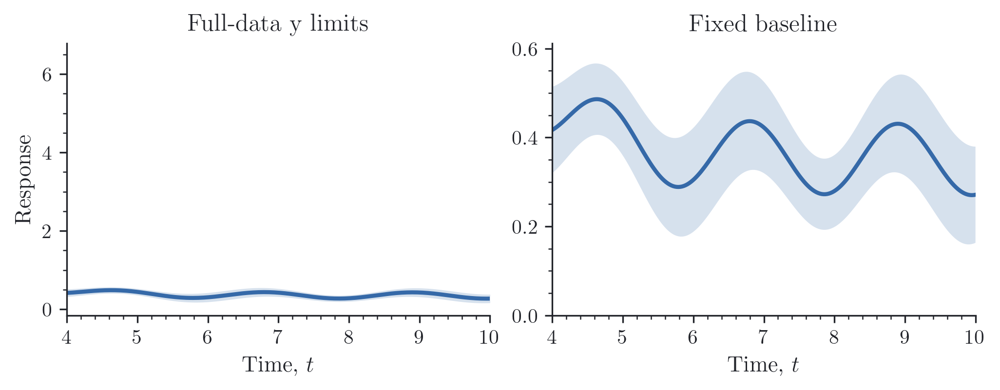

# Uncertainty and limits

### Shaded bands

Once a line is drawn, `shade()` can add a band using the same color. A single
width gives a symmetric band; separate lower and upper widths allow it to be
asymmetric:

```python
import numpy as np
import reiplotlib as rpl
from reiplotlib import layouts as layout

with rpl.rc_context({"text.usetex": True}):
    fig, axes = layout.subplots(1, 2, width="double", aspect=0.38,
                               layout="constrained", sharey=True)
    x = np.linspace(0, 6, 200)
    y = np.exp(-x / 2)
    std = 0.025 + 0.05 * y

    axes[0].plot(x, y)
    rpl.shade(axes[0], x, y, std)
    axes[0].set_title(r"Symmetric: $y\pm\sigma$")

    axes[1].plot(x, y)
    rpl.shade(axes[1], x, y, (0.5 * std, 1.8 * std))
    axes[1].set_title("Asymmetric")

    for ax in axes:
        ax.set(xlabel=r"Time, $t$", xlim=(0, 6))
        rpl.clean_axes(ax, grid=False)
    axes[0].set_ylabel("Response")
    rpl.export.savefig(fig, "figures/shading")
```

{ width="720" }

`yerr` accepts a scalar, an array of symmetric widths, or a `(2, N)` array of
lower and upper widths. Widths are nonnegative distances from `y`, not absolute
bounds; pass whichever standard deviations or interval widths you computed.
`shade()` returns the filled artist and forwards options such as `alpha`,
`where`, `step`, and `label` to Matplotlib's `fill_between()`.

### Error bars

Small error bars can clutter a figure when their caps are wider than the
uncertainty itself. `rpl.errorbar()` can hide bars that fit inside their markers.
Hollow markers make the difference easier to see:

```python
from reiplotlib import options as o

with rpl.rc_context({"text.usetex": True}):
    fig, axes = layout.subplots(1, 2, width="double", aspect=0.40,
                               layout="constrained", sharex=True, sharey=True)
    x = np.arange(1, 9)
    y = 0.55 + 0.12 * np.sin(0.8 * x)
    se = np.array([0.001, 0.003, 0.012, 0.045, 0.080, 0.006, 0.025, 0.002])

    for ax, hide, title in zip(axes, (True, False),
                               ("Adaptive hiding", "All error bars")):
        rpl.errorbar(ax, x, y, yerr=se, hide_small_errors=hide,
                     **o.errorbar(rpl.colors.blue, markersize=7,
                                  markerfacecolor="none", markeredgewidth=1.2,
                                  capsize=3, elinewidth=0.9))
        ax.set(title=title, xlabel=r"Sample, $i$", xlim=(0.5, 8.5),
               ylim=(0.30, 0.82), xticks=[2, 4, 6, 8])
        rpl.clean_axes(ax, grid=False)
    axes[0].set_ylabel(r"Estimate, $y_i$")
    rpl.export.savefig(fig, "figures/errorbars")
```

{ width="720" }

Both panels use the same estimates and uncertainties. Hollow markers make small
bars visible in the right panel; adaptive hiding removes those shorter than the
marker diameter on the left.

Bars smaller than their markers are hidden individually and reappear when a zoom
or resize makes them visible. Caps follow their bars; the uncertainty values and
autoscaling bounds remain intact. Set `hide_small_errors=False` to show every
bar. Polar axes and one-sided limit arrows require this opt-out. Inputs are fixed
at creation; recreate the artist to change the data.

### Visible limits

When we zoom into the tail of a curve, an earlier peak can leave a lot of empty
space on the y axis. Setting the x limits does not recalculate that range;
`autoscale_y()` fits it to the part of the curve still in view:

```python
with rpl.rc_context({"text.usetex": True}):
    fig, axes = layout.subplots(1, 2, width="double", aspect=0.38,
                               layout="constrained")
    x = np.linspace(0, 10, 400)
    y = 8 * np.exp(-x) + 0.15 * np.sin(3 * x)

    for ax in axes:
        ax.plot(x, y)
        ax.set(xlim=(4, 10), xlabel=r"Time, $t$")
        rpl.clean_axes(ax, grid=False)
    axes[0].set(title="Default y limits", ylabel="Response")
    axes[1].set_title("Visible-range y limits")
    rpl.autoscale_y(axes[1], margin=0.08)
    rpl.export.savefig(fig, "figures/autoscale")
```

{ width="720" }

The large initial peak is outside both panels. Fitting the y limits to the
visible data reveals the small oscillations without changing the curve.

Shared-y panels combine their visible ranges, including error bars and crossing
line segments. Shaded bands from `shade()` or `fill_between()` contribute their
visible edges too. Manual y limits are preserved unless `override=True`.
Use `watch=True` to update on x-limit changes; the returned `(axes, callback_id)`
pairs can be disconnected with `axes.callbacks.disconnect(callback_id)`.

### Shaded bands with a fixed baseline

For a positive quantity, we may want to keep zero in view while letting the
upper limit follow the data. Pass `bottom=0`; the visible uncertainty band also
counts toward the free upper limit:

```python
with rpl.rc_context({"text.usetex": True}):
    fig, axes = layout.subplots(1, 2, width="double", aspect=0.38,
                               layout="constrained", sharex=True)
    x = np.linspace(0, 10, 400)
    y = 6 * np.exp(-x) + 0.35 + 0.08 * np.sin(3 * x)
    se = 0.08 + 0.04 * np.cos(x) ** 2
    for ax in axes:
        ax.plot(x, y)
        rpl.shade(ax, x, y, se)
        ax.set(xlim=(4, 10), xlabel=r"Time, $t$")
        rpl.clean_axes(ax, grid=False)
    axes[0].set(title="Full-data y limits", ylabel="Response")
    axes[1].set_title("Fixed baseline")
    rpl.autoscale_y(axes[1], bottom=0, margin=0.08)
    rpl.export.savefig(fig, "figures/autoscale-band")
```

{ width="720" }

`top=` works in the same way for a fixed upper limit. Margin is added only to
the free side, so the requested bound remains exact. On logarithmic axes, fixed
bounds must be positive; inverted axes keep their direction. If a view contains
no data, its limits are left alone. A fixed bound beyond all visible data on the
opposite side raises `ValueError` rather than reversing the axes.

Bands are clipped at the visible x limits, including edges that cross the view
without a sample inside it. Masked gaps remain gaps. Other data-coordinate
polygon collections are also included; images, individual patches, and bars
are not.
