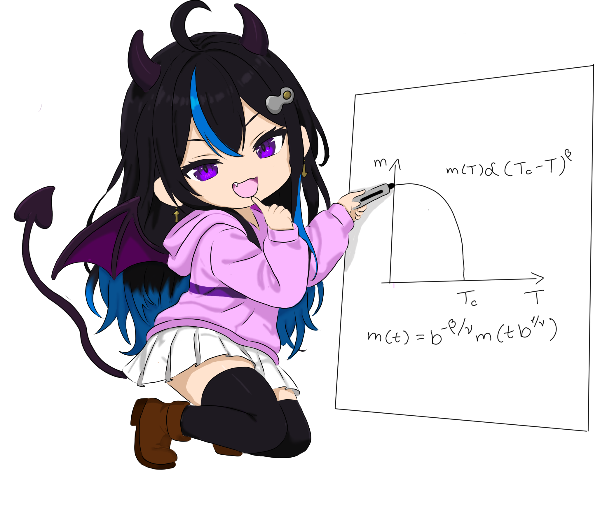
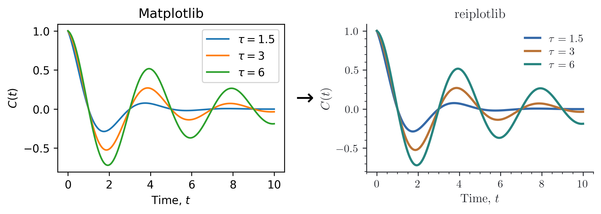

# reiplotlib

{ width="520" }

Reiplotlib is a collection of Matplotlib utilities, styles, and slightly
opinionated presets for consistent, publication-ready figures.

Part of **Reiko Studio**.



Most of a figure is still ordinary Matplotlib. Reiplotlib supplies a few choices
you would otherwise repeat: colors, typography, publication widths, and small
helpers for uncertainties and legends. You can use just the style or bring in
the other pieces as you need them.

## Installation

```bash
pip install git+https://github.com/reiko-studio/reiplotlib.git
```

You will need Python ≥3.10 and Matplotlib ≥3.7. The default style uses LaTeX;
if you do not have a TeX installation, pass `{"text.usetex": False}` to the
style context.

```python
import reiplotlib as rpl

with rpl.rc_context():
    fig, ax = rpl.layouts.subplots(width="single", aspect=0.75)
    ax.plot([0, 1, 2], [0.2, 0.8, 0.5])
    ax.set(xlabel="Time", ylabel="Response")
    rpl.clean_axes(ax, grid=False)
    rpl.export.savefig(fig, "figures/response")
```

The [first figure tutorial](examples/first-figure.md) walks through a complete
plot. The other examples cover [colors](examples/colors.md),
[figure sizes](examples/sizing.md), [repeated series](examples/series.md),
and [shared legends](examples/legends.md), with rendered figures beside the code.
For signatures and details, browse the [API reference](reference.md).
